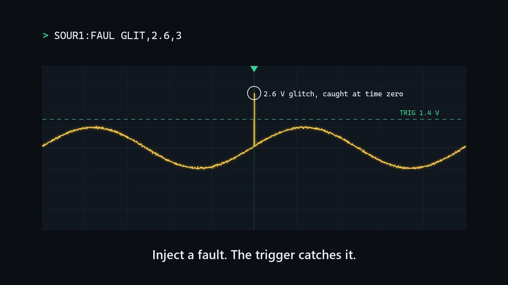

# OpenScope

OpenScope is a software oscilloscope engine in C++20. It samples simulated signals, triggers them into captures, measures the captures, and exposes all of it to scripts over SCPI.

<p align="center">
  <a href="docs/media/openscope.mp4"></a>
</p>
<p align="center"><sub>21 seconds, with sound. Every command, reply, waveform and spectrum in it came from the real engine.</sub></p>

The live web display (which will follow [ADR 0001](docs/adr/0001-ui-speaks-scpi-over-websocket.md)) and observability are planned follow-ups and not part of v1.

Further reading:

- [`GLOSSARY.md`](GLOSSARY.md): the domain vocabulary
- [`docs/adr/`](docs/adr/): the main design decisions
- [`docs/scpi-reference.md`](docs/scpi-reference.md): the SCPI grammar, error codes and commands

## Build and test

Requirements:

- Linux (developed on Ubuntu 24.04)
- GCC 14 or Clang 18
- CMake 3.25+ and Ninja
- [vcpkg](https://github.com/microsoft/vcpkg), with `VCPKG_ROOT` pointing at it

Dependencies are declared in `vcpkg.json`, and vcpkg installs them automatically on the first configure.

```sh
cmake --preset debug      # configure
cmake --build --preset debug
ctest --preset debug
```

CMake reads `CXX` only when it creates a build directory, and every preset reuses `build/<preset>`. To pick or switch the compiler, configure with `--fresh`, which discards the cached configuration:

```sh
CXX=clang++-18 cmake --fresh --preset debug
```

The presets are:

- `debug`
- `release`
- `asan`: AddressSanitizer + UndefinedBehaviorSanitizer
- `tsan`: ThreadSanitizer
- `coverage`: always Clang, for llvm-cov

Each one builds into `build/<preset>`, and warnings are errors in every preset. With Clang, the sanitizer and coverage presets need the compiler runtime (`libclang-rt-18-dev` on Ubuntu).

Formatting and lint use the committed `.clang-format` and `.clang-tidy`:

```sh
clang-format-18 --dry-run --Werror $(git ls-files '*.cpp' '*.hpp')
CXX=clang++-18 cmake --fresh --preset debug -DCMAKE_CXX_CLANG_TIDY=clang-tidy-18   # then build: findings fail it
```

## Running the engine

`openscope-engine` runs the instrument live and serves SCPI over TCP until Ctrl+C or SIGTERM. At `*RST` the instrument has 4 channels on a 1 MS/s sample clock. The debug, release, asan, tsan and coverage presets build the engine into `build/<preset>/src/`.

```sh
build/release/src/openscope-engine            # 127.0.0.1:5025
build/release/src/openscope-engine --port 0   # a free port, named in the "listening" log line
```

| Option | Default | Meaning |
|---|---|---|
| `--address <ip>` | `127.0.0.1` | Local IP address to listen on. The instrument has no authentication, and any other address exposes it to the network. Host names are not resolved. |
| `--port <0-65535>` | `5025` | TCP port; `0` picks a free one. |
| `--idle-timeout <1-86400>` | `300` | Seconds a client may go without sending a command or getting a reply before it is disconnected. A client waiting on `*OPC?` or `*WAI` is never idle. |
| `--seed <n>` | `0` | Seed of the generators' noise. The same seed and the same commands give the same signals. |
| `-h`, `--help` | | Print the options and exit. |

Logs go to standard error, one JSON object per line. Each line has `time` and `event`, and the events are `listening`, `connect`, `refuse`, `disconnect`, `live`, `error` and `stopping`.

`live` reports what live mode has lost so far. The engine logs it once after each second in which any of these counts changed:

- `dropped_blocks`: processing fell behind (NFR-1 asks for none)
- `skipped_samples`: acquisition fell behind the wall clock
- `discarded_captures`: captures that would have spanned a dropped block

`stopping` carries the same three counts, along with the `signal` that stopped the engine.

An invalid option exits with status 2. A failure to start, such as a port in use, logs an `error` event and exits with status 1.

```console
$ printf '*IDN?\n' | nc -q 1 127.0.0.1 5025
OpenScope,OS-4,000001,0.1.0
```

[`docs/scpi-reference.md`](docs/scpi-reference.md) lists the commands and the connection rules: one Session per connection, 4 KB lines, 64 MiB replies and 8 clients.

## Python client

`python/` holds `openscope-client`, a Python 3.12+ package with typed methods for the SCPI commands. It talks to the engine over a raw TCP socket (standard library only) or through PyVISA (the `visa` extra), with the same API either way. After every line it reads the Session's error queue. If the line queued errors, it raises `ScpiError` with the SCPI code and message.

```python
from openscope_client import Measurement, OpenScope

with OpenScope.connect(port=5025) as scope:  # or OpenScope.open_visa("TCPIP0::localhost::5025::SOCKET")
    print(scope.identify())
    scope.generator(1).frequency = 2000
    scope.single()
    scope.wait_complete()  # SINGle;*OPC?: the capture is complete
    waveform = scope.waveform.read()  # float32 block, placed in time with WAV:PRE?
    print(scope.measure(Measurement.FREQUENCY, channel=1))
```

`python/requirements-dev.txt` pins the package's tools and test dependencies. There are two test suites:

- `python/tests/unit` tests the client against a scripted stand-in.
- `python/tests/integration` is the TCP suite. Each test starts the engine named by `OPENSCOPE_ENGINE_PATH` on a free port, drives it over both transports, and checks that it exits cleanly.

CI runs both suites against the release and ASan + UBSan engines and publishes the results as JUnit XML.

```sh
python3 -m venv .venv && .venv/bin/pip install -r python/requirements-dev.txt -e python
cd python && ../.venv/bin/ruff check . && ../.venv/bin/ruff format --check .
OPENSCOPE_ENGINE_PATH=$PWD/../build/release/src/openscope-engine ../.venv/bin/pytest
```

The TCP suite checks every measurement against the Generator's ground truth, within the spec's NFR-5 and NFR-6 tolerances. It also checks the trigger, faults, run control, statistics and the FFT.

`pytest -m latency -s` prints the SCPI latency numbers (NFR-4). The long stability test runs only when asked for, either with `OPENSCOPE_SOAK_SECONDS=3600 pytest --soak -m soak` or through the Soak workflow. See [`docs/benchmarks.md`](docs/benchmarks.md) for both.

## Fuzzing

The `fuzz` preset (always Clang) builds a libFuzzer target. It splits raw bytes into lines and feeds them to the instrument's execute-line entry point under ASan and UBSan. The low bit of a line's first byte sends it to one of two Sessions, so cross-Session paths are fuzzed too.

CI runs the fuzzer for 60 seconds on every pull request. To run it longer locally:

```sh
cmake --preset fuzz && cmake --build --preset fuzz
mkdir -p fuzz-corpus
build/fuzz/fuzz/execute_line_fuzzer -max_total_time=600 -max_len=8192 -dict=fuzz/scpi.dict \
  fuzz-corpus fuzz/corpus
```

New inputs go to `fuzz-corpus`, the first directory, and `fuzz/corpus` holds the committed seeds. A crash leaves its input in a `crash-*` file; pass that file to the fuzzer to replay it.

Longer runs are recorded in [`docs/incidents.md`](docs/incidents.md). It also holds short notes on the real bugs found by the sanitizers, the fuzzer, the soak and the other verification tests.

## Coverage

CI fails when line coverage of the trigger, measurement or SCPI parser area is under 85 % (NFR-11). Each area is gated on its own, not on the sum.

The trigger area holds edge detection (`trigger.cpp`), capture assembly (`capture_assembler.cpp`: pre-trigger samples, holdoff, the Auto timeout and where time zero lands) and block assembly (`block_assembler.cpp`: discarding the capture in progress at a settings change or a dropped block). `tools/coverage_gate.py` sets the threshold, the areas and their files. The llvm-cov report is the `llvm-cov-report` artifact of the CI run.

```sh
CXX=clang++-18 cmake --preset coverage && cmake --build --preset coverage && ctest --preset coverage
python3 tools/coverage_gate.py   # needs llvm-cov-18 and llvm-profdata-18; writes build/coverage/coverage-report.txt
```

## Benchmarks

The `benchmark` preset (Release) installs the vcpkg `benchmarks` feature (Google Benchmark) and fetches KissFFT as a reference only. It builds:

- `fft_benchmark`, which times our FFT against KissFFT from 4K to 1M points. KissFFT is compiled with the same compiler and flags as our code.
- `ring_buffer_benchmark`, which times the SPSC ring buffer between two threads.

CI runs every `*_benchmark` on every pull request. It reports the numbers and uploads them as JSON (the `benchmark-results` artifact), without gating on them; a crash fails the step. The same job runs `live_run` for 20 s at 4 channels x 1M points and reports its drop counts the same way. [`docs/benchmarks.md`](docs/benchmarks.md) records measured results.

```sh
CC=gcc-14 CXX=g++-14 cmake --preset benchmark && cmake --build --preset benchmark
build/benchmark/bench/fft_benchmark
build/benchmark/bench/ring_buffer_benchmark
build/benchmark/bench/live_run 60   # live mode at 4 channels x 1 MS/s for 60 s (a sample rate, then a record length, may follow): prints skipped samples, drop counts and *IDN? latency
```

## CI

Every pull request runs the format check (clang-format and ruff), GCC debug and release, Clang debug with clang-tidy, ASan + UBSan, TSan, the coverage gate, the 60-second fuzz smoke run and the pytest suite. The benchmarks run too, but they are only reported and never block a merge. `main` requires the other checks to pass before a pull request can merge.

## License

MIT. See [`LICENSE`](LICENSE).
